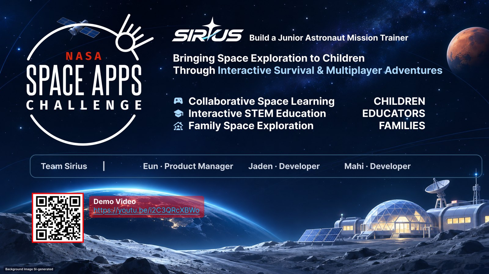
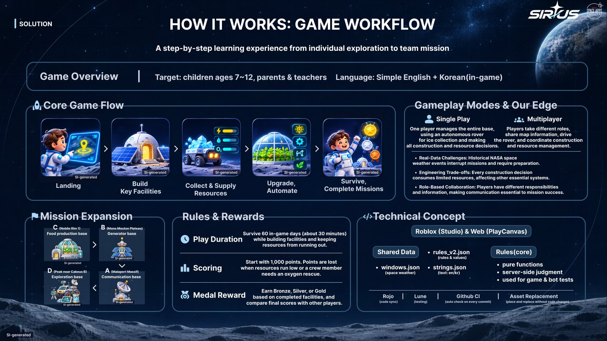
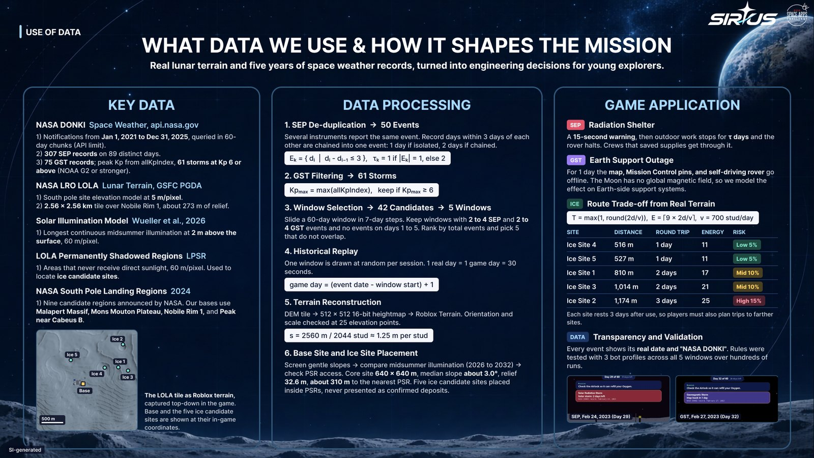
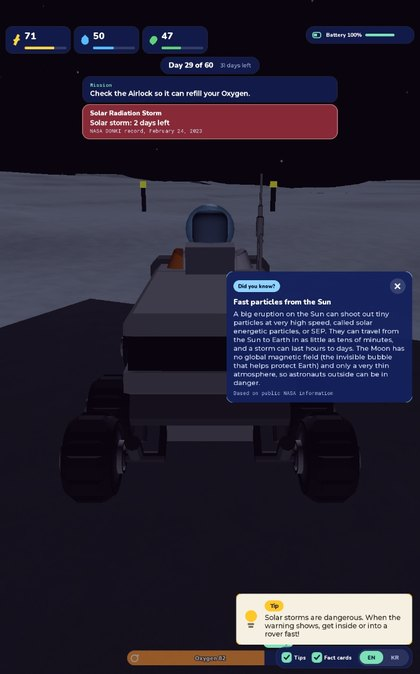
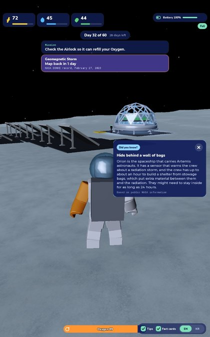
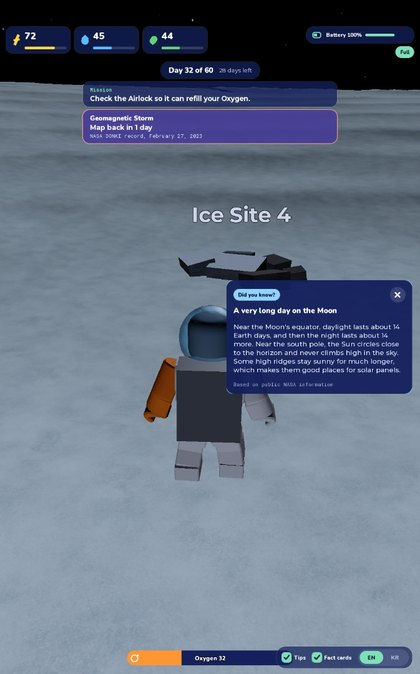
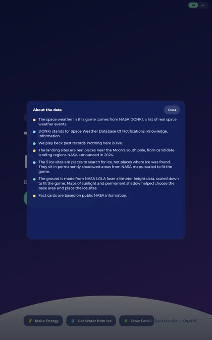
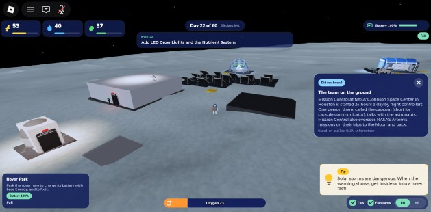
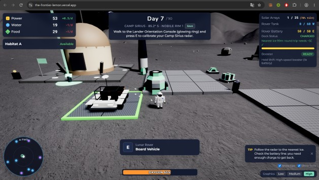

<p align="center">
  
</p>

<h2 align="center">The Frontier</h2>
<p align="center"><b><i>A Lunar Base Mission Trainer for Young Explorers</i></b><br>
Build and run a food production base at the lunar south pole, using real NASA terrain and space weather data.</p>

<p align="center">
  <a href="https://the-frontier-game.vercel.app"></a>
  <a href="https://www.roblox.com/games/139751582320388/The-Frontier"></a>
  <a href="https://drive.google.com/file/d/1S7cH14tDa2MyenZAvNnnORG650mdatj-/view?usp=sharing"></a>
  <br>
  
  
  
  <br>
  
  
  
  
</p>

<p align="center">
  <a href="#why-we-built-it">Why</a> &nbsp;|&nbsp;
  <a href="#our-approach">Approach</a> &nbsp;|&nbsp;
  <a href="#how-a-mission-works">Gameplay</a> &nbsp;|&nbsp;
  <a href="#real-nasa-data">NASA Data</a> &nbsp;|&nbsp;
  <a href="#in-the-game">Screenshots</a> &nbsp;|&nbsp;
  <a href="#getting-started">Development</a> &nbsp;|&nbsp;
  <a href="#team-sirius">Team</a>
</p>

---

## Overview

**The Frontier** is a lunar base survival game for children aged 7 to 12, and for the parents, siblings, and teachers who play alongside them. It was built by Team Sirius for the NASA Space Apps Challenge 2026 challenge **"Build a Junior Astronaut Mission Trainer."**

Players have **60 in-game days (about 30 minutes)** to build and run a food production base at the lunar south pole. They install solar panels, send a rover to collect ice from candidate sites in permanently shadowed regions, and grow food in a greenhouse, all while keeping energy, water, and food from running out. Every choice has a cost, and no option is always correct.

| Version | Link | Source |
|---|---|---|
| Web (PlayCanvas) | [the-frontier-game.vercel.app](https://the-frontier-game.vercel.app) | [MuhtasimMahim/The-frontier-Space-Game-Team-Sirius](https://github.com/MuhtasimMahim/The-frontier-Space-Game-Team-Sirius) |
| Roblox | [The Frontier on Roblox](https://www.roblox.com/games/139751582320388/The-Frontier) | This repository |

## Why we built it

Children this age are curious about space, but most space games for them fall into one of two groups. Some have complex controls and technical concepts that young players cannot follow. Others are simple enough to play but do not show how real missions work.

What both miss is the core of space engineering: **making decisions under limits.** On the Moon, power, water, and food are scarce, every resource spent on one system is taken from another, and conditions such as space weather cannot be controlled. We wanted a game where children learn this by making those decisions themselves, in a game simple enough for a 7-year-old and still honest about how real missions work.

## Our approach

| | Principle | What it means in the game |
|---|---|---|
| 1 | **Teach trade-offs, not answers** | A nearby ice site is cheap but needs three days to recover. LED Grow Lights speed up harvests but use more power. Saving supplies for a solar storm slows construction. |
| 2 | **Use real data, honestly** | Space weather is replayed from real NASA DONKI records with their original dates, never presented as live. Ice sites are places to search for ice, not confirmed deposits. |
| 3 | **Keep the data, change the design** | Ice candidate sites stay at their real positions in shadowed regions. When that made rover trips too long, we moved the base, not the ice. |
| 4 | **Cooperation without chat** | Chat is restricted for younger players on Roblox, so one player acts as Mission Control and guides the crew with map pins and direction arrows. |
| 5 | **Failure that teaches** | Running out of oxygen does not end the game, the score stays hidden until the end, and failure screens suggest what to try next time. |

## How a mission works

<p align="center"></p>

1. **Land** at Base C in Nobile Rim 1, check the airlock, and install solar panels.
2. **Collect water** by sending a rover to one of five ice candidate sites. Farther sites cost more energy and carry a higher risk of rover damage.
3. **Grow food** in a greenhouse that harvests every five days, then choose among LED Grow Lights, a Nutrient System, and Hydroponics.
4. **Automate** one ice site with a water pipe, at the cost of energy and daily upkeep.
5. **Finish the mission** with a bronze, silver, or gold medal. The score starts at 1,000 and is revealed on the results screen with the reason for each deduction.

In solo play the rover drives itself. In multiplayer (up to 4 players), the crew splits into roles: Mission Control, rover driver, and builder.

## Real NASA data

<p align="center"></p>

| Data | How we processed it | What players see |
|---|---|---|
| **NASA DONKI** space weather, 2021 to 2025 | 307 SEP records grouped into 50 events (records within 3 days chained), 61 geomagnetic storms at Kp 6 or above, 42 candidate 60-day windows narrowed to 5 | One real window replayed per session. SEP: 15-second warning, then shelter for 1 to 2 days. GST: map, Mission Control pins, and self-driving rover offline for 1 day |
| **NASA LRO LOLA** elevation, 5 m/pixel | 2.56 x 2.56 km tile of Nobile Rim 1 converted to a 512 x 512 heightmap, about 1.25 m per stud | The terrain you walk and drive on |
| **Illumination model** and **LOLA permanently shadowed regions** | Base site chosen for gentle slopes and sunlight, five ice candidate sites placed inside shadowed regions | Real trade-off between near and far ice: 516 m to 1,174 m, 1 to 3 days, low to high risk |

Every event shows its original date with "NASA DONKI", the results screen summarizes the space weather that was replayed, and an **About the data** screen explains each source. The generator is [`tools/donki/build_windows.py`](tools/donki/build_windows.py), and the selected windows are in [`data/donki/windows.json`](data/donki/windows.json).

## In the game

<table>
  <tr>
    <td align="center" width="25%"><br><sub><b>SEP</b> replayed from Feb 24, 2023</sub></td>
    <td align="center" width="25%"><br><sub><b>GST</b> replayed from Feb 27, 2023</sub></td>
    <td align="center" width="25%"><br><sub><b>Ice Site 4</b>, a candidate site</sub></td>
    <td align="center" width="25%"><br><sub><b>About the data</b> screen</sub></td>
  </tr>
</table>

<table>
  <tr>
    <td align="center" width="50%"><br><sub>Roblox version</sub></td>
    <td align="center" width="50%"><br><sub>Web version (PlayCanvas)</sub></td>
  </tr>
</table>

## Built with

| Area | Tools |
|---|---|
| Game | Roblox Studio, Luau, [Rojo](https://rojo.space/) |
| Quality | [Lune](https://lune-org.github.io/docs) tests (about 900), Selene, StyLua, GitHub Actions |
| Data | Python and the NASA API (DONKI), LOLA GeoTIFF processing |
| Art and design | Blender (greenhouse, water tank, water pipe, airlock), Figma |
| Web version | PlayCanvas, sharing `data/rules_v2.json`, `data/donki/windows.json`, and `i18n/strings.json` with this repository |

The game rules are pure functions in `src/shared/Rules.luau`, so the same logic runs in the game and in bot simulations. Three bot profiles (expert, returning player, first-time player) played hundreds of sessions across all five space weather windows to tune the difficulty.

## Repository structure

| Path | Studio location | Contents |
|---|---|---|
| `src/shared` | ReplicatedStorage.Shared | Rules, mission config, space weather data, localization |
| `src/server` | ServerScriptService.Server | Mission flow, world, rover, space weather, records |
| `src/client` | StarterPlayer.StarterPlayerScripts.Client | HUD, console, map, results, settings |
| `tests` | not synced | Lune unit tests, server smoke tests, bot simulations |
| `tools` | not synced | DONKI window builder, rules export, i18n build |
| `data` | not synced | DONKI windows and rules shared with the web version |
| `i18n` | not synced | English and Korean strings (`strings.csv`) |

## Getting started

1. Install [Rokit](https://github.com/rojo-rbx/rokit), then install the pinned tools (rojo, selene, stylua, luau-lsp, lune):

   ```sh
   rokit install
   ```

2. Install [Roblox Studio](https://create.roblox.com/) and the Rojo plugin:

   ```sh
   rojo plugin install
   ```

3. Start the sync server and press **Connect** in the Rojo plugin inside Studio:

   ```sh
   rojo serve
   ```

4. Lint, format, and test:

   ```sh
   selene src tests
   stylua --check src tests
   lune run tests/run.luau
   ```

5. Build a place file:

   ```sh
   rojo build default.project.json -o build.rbxl
   ```

To rebuild the space weather windows from NASA DONKI, set `NASA_DATA_KEY` in your environment and run `python3 tools/donki/build_windows.py --refresh`. Without `--refresh`, the script uses the cached `data/donki/raw.json`.

## Team Sirius

| Name | Role |
|---|---|
| Eun | Product Manager |
| Jaden | Developer (Roblox version) |
| Mahi | Developer (Web version) |

## Use of AI

We used Claude Code (Anthropic) during development to turn meeting notes into a plan, generate and review game code under team supervision, run balance simulations, check translations, and draft educational fact cards. Every fact card was checked against NASA sources, and all design decisions were made by the team. Illustrations and background images in our presentation were generated with AI tools and carry a visible "SI-generated" watermark.

## Data sources and credits

- [NASA DONKI](https://ccmc.gsfc.nasa.gov/tools/DONKI/) via [NASA Open APIs](https://api.nasa.gov/)
- [NASA GSFC PGDA: LRO LOLA South Pole Site Elevation Data](https://pgda.gsfc.nasa.gov/products/78)
- [NASA GSFC PGDA: LOLA Permanently Shadowed Regions](https://pgda.gsfc.nasa.gov/products/69)
- [Wueller et al. (2026), Lunar South Pole Illumination Modeling](https://zenodo.org/records/17084058)
- [NASA: Artemis Lunar South Pole Candidate Landing Regions (2024)](https://www.nasa.gov/news-release/nasa-provides-update-on-artemis-iii-moon-landing-regions/)
- [NOAA SWPC Space Weather Scales](https://www.spaceweather.gov/noaa-scales-explanation)
- [Ultimate Space Kit by Quaternius (CC-BY)](https://sketchfab.com/3d-models/ultimate-space-kit-84c108ff2bcf4d4cbf2adff74a942822)
- [Roblox Creator Store](https://create.roblox.com/store/audio) free audio

Fact card sources are listed in [`docs/content/FACTS_V2.md`](docs/content/FACTS_V2.md).

<p align="center"><sub>Made by Team Sirius for the NASA Space Apps Challenge 2026, Seoul. This project is not affiliated with or endorsed by NASA.</sub></p>
